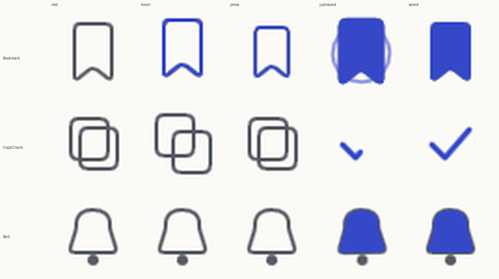

# What else Rive could do for Sodhsetu: small icons first, then the ideas (research of 1 Nov 2026)

Asked: besides the bridge ([setu-rive.md](setu-rive.md)), what else can the Rive CLI do here, for example a small animation on every icon when it is hovered, and what other ideas are there? The facts below
come from the CLI's own documentation (`rive docs`), from a prototype built and run with the CLI, and from measurements in a real browser (Edge, two pixels per CSS pixel). **Built on 1 Nov 2026 from this list: the bridge, the icon motion kit, the reading scene and the drop box (section 7).**

## 1. The short answer

| Question | Answer |
|---|---|
| Can a small icon react to hover, press and a toggle with Rive? | **Yes, and it works with real buttons.** Three prototype icons (save a paper, copy then check, notify me) were driven by the page's own `<button>`: mouse, keyboard focus and Space all worked, and `aria-pressed` stayed the DOM's |
| Should every icon be a Rive animation? | **No.** The icons themselves are tiny (3 icons, 4 states each: 4.5 KB, **1.2 KB** gzip) but the runtime that plays them is **about 450 KB** gzip. The same hover effects in CSS or with the Motion library the app already ships cost about nothing extra |
| Then where is Rive worth it? | Where there is a *scene*, not an icon: something with several states that react to data or to the pointer, drawn once and edited by a designer. The bridge is one. Section 4 lists the others |

## 2. The icon experiment

Three artboards in one file, one view model (`hover`, `down`, `on` booleans and two colours: `ink`, `accent`, the page's tokens), four states each, blended in 70 to 160 ms:

- **Save a paper** (bookmark): lifts 2 px and takes the accent colour on hover, shrinks a little when pressed, fills and sends one ring out when saved, and stays filled.
- **Copy a reference**: the two sheets part on hover; when copied the sheets fade and a check is drawn with a trimmed stroke.
- **Notify me** (bell): rings once (a swing that dies away, 0.6 s) on hover or focus, fills when on.

How it was driven, and why this way: the page's `<button>` owns the label, keyboard, focus ring and `aria-pressed`. Its `pointerenter`, `focus` (only when it is a keyboard focus), `pointerdown`, `keydown` and
`click` set the three booleans on the Rive file; Rive only draws the face. A screen reader never meets the canvas (`pointer-events: none`, `aria-hidden`). Rive can also take pointer input itself
(listeners on shapes, and `semantics` for roles and labels), but that would make Rive responsible for keyboard and screen readers, which the DOM already does well.

Measured in Edge with the lite runtime: **24 icons at rest cost 2.2% of the main thread (11.7% with the processor 4x slower); when each icon is paused as soon as it has settled, 0.0% (0.1%)**. So
the pattern is: play on hover, focus or click, pause about a second after it settles. Heap stayed at 4 to 6 MB.

## 3. Ways to animate an icon, by cost

| Way | Extra download (gzip) | Hover, press, toggle | Edited by a designer | Fits many icons | Notes |
|---|---|---|---|---|---|
| CSS on the inline SVG icons (the app draws about 60 different Lucide icons) | **0** | yes (`transition`, `@keyframes`, `stroke-dashoffset` to draw a line) | in code | yes | respects `prefers-reduced-motion` with one media query; cannot morph one path into another |
| The Motion library (already in the app: 4 KB and 18 KB chunks) | **0 more** | yes (springs, gestures, sequences) | in code | yes | the intro film already uses it |
| Lottie (`lottie-web` light) | about 45 KB (74 KB full) | plays a fixed timeline; interaction is code you write around it | in After Effects | yes | no state machine; each icon is a JSON file |
| Rive (`canvas-lite`) | **about 450 KB** (116 KB script, 331 KB wasm) | yes, with state machines and data binding | in the Rive editor (`.rev`) | yes, once paused when idle | the cost is the runtime, paid once per page |

So for the 60 or so icons the app already draws, the honest engineering answer is **CSS and Motion first**: a small "icon motion kit" (a hover lift, a press, a draw-on check, a ring of the bell) would give
most of the delight for nothing. Rive makes sense for an icon only on a page that has loaded the Rive runtime for another reason (the bridge page).

## 4. Ideas, ranked (value to the reader, cost, my verdict)

| # | Idea | Where | Why it helps | Cost | Verdict |
|---|---|---|---|---|---|
| 1 | **The bridge** (scan progress, [setu-rive.md](setu-rive.md)) | running scan | the 30 to 60 s wait becomes the product's own picture; gaps become visible | lazy 450 KB on that page only | **Do first.** Prototype done, numbers measured |
| 2 | **An icon motion kit in CSS and Motion** (not Rive) | every icon button | small, consistent feedback on hover, press, saved, copied, notify | none | **Do.** Same states as the prototype, written once, honours reduced motion |
| 3 | **A paper's "reading" scene** | upload and open-access ask: stages "reading pages", "indexing", "checking" | uploads and OCR take seconds to minutes (60 scanned pages a day); the page count is data the file can show (pages turning, a progress ring) | shares the runtime if the bridge exists; own file about 5 KB | **Good second Rive piece**, reuses the bridge's runtime and approach |
| 4 | **A drop zone that opens as a file approaches** | My Workspace "Add a paper" | feedback while dragging: a door opens, closes on leave, "thanks" on drop; pointer-driven | page that already shows upload | Nice; check the drag events reach a canvas and keep the plain button |
| 5 | **"Follow the citation", hands-on** | intro page, after first paint | the film shows it; here a visitor drags a claim to its sentence | would put the runtime on the intro, which has a strict first-paint budget | **Not now.** If ever: only after the film, loaded when scrolled to, never before the first paint |
| 6 | **The coverage map of an idea** | Idea Check | the facets and the papers that cover them, as a small interactive map fed by the check's data | own file; the same facts are in a table already | Maybe; a plain SVG may do better, because it must be read by screen readers cell by cell |
| 7 | **A quiet "thinking" scene** while the answer is written | the prompt box | the first word takes 13 to 18 s ([p7-latency.md](p7-latency.md)); a small scene saying "reading 8 papers" would help | the prompt box is the home page: it would have to load only after a message is sent | Worth a test, but the better fix is a faster first word |
| 8 | **Verified, not found, retracted stamps** | lists of references (up to 100 at a time) | a small sign per reference | 100 instances | **No.** CSS or SVG: the state is a plain badge and many instances are the wrong shape for a runtime |
| 9 | **A native phone app** (`rive build` makes Android and iOS apps) | later | not a general app: a Rive scene wrapped for a phone | store accounts, signing | **No.** Out of scope |
| 10 | **A background of generative shaders (WGSL) or a citation graph on a canvas** | intro | atmosphere | heavy, and the earlier design note decided against a decorative background | **No.** Decoration without a fact |

## 5. What would make any Rive piece safe to ship (the rules from the bridge, for all of them)

1. The runtime is a **lazy chunk**, loaded only on a page that shows a Rive piece, never in the first load; it has its own line in `apps/web/scripts/budget.mjs`.
2. **The text and the controls are the DOM's**; the picture is decoration. Nothing is told only by the picture.
3. **Not mounted** under `prefers-reduced-motion`, on `Save-Data`, when the files cannot be loaded, or offline: the page looks as it does today.
4. **Paused** when nothing moves, when the tab is hidden, when scrolled out of view.
5. Colours come from the page's tokens (light, dark, sepia) as properties of the file; no second file for a theme.
6. The file has **no scripts**, so it needs no Rive login and no signing; it is built by the CLI from text (RML), generated where the shapes repeat, and committed with the generator.
7. Each file has a **headless storyboard** (`rive . --screenshot=… --data=… --advance=…`) so a change of look is seen, and compared, without opening a window.

## 6. Decisions for the owner

1. Is the order right: the bridge, then the CSS and Motion icon kit, then (if the bridge is liked) the reading scene?
2. The look of the icon kit (how much lift, how fast the bell rings, the colour of "saved") is the owner's call; the prototype is a starting point, not a decision.
3. Rive account: not needed for any of the above. It is needed only if the owner wants to open a piece in the Rive editor (`rive --rev`, `rive push`): then one login, once.

## 7. What was built from this list (1 Nov 2026)

The owner asked for four of them: 1 the bridge, 2 the icon motion kit, 3 the reading scene and 4 the drop box. For the icons the owner meant the ones the app already draws, so it is CSS.

| # | Built as | Where | Tested by |
|---|---|---|---|
| 1 | the bridge, [setu-rive.md](setu-rive.md) (status in its section 10) | the page of a running scan | `e2e/rive.mjs`, unit tests of the mapping |
| 2 | CSS on the Lucide classes, [icon-motion.md](icon-motion.md): no runtime, no download | every pressable icon | `e2e/icons.mjs`, 36 checks |
| 3 | **the reading scene**: a paper under a line that sweeps it, a page set aside as each is read (for page pictures, read one by one), a ring that fills a third for each of the three steps and is eased over 0.45 s, a check drawn when it is done; 96 x 96, shown at 52 px beside the file's name | the upload rows of My Workspace | `e2e/rive.mjs` (modes 1, 2 and 3 seen in a real upload, the ring never goes back and ends full, follows the theme, axe), unit tests of `readingPose` |
| 4 | **the drop box**: a box whose lid opens when a file is carried over it (the paper rises and waits), takes the paper when it is dropped and closes with a small rebound, closes without it when the file is carried away, dims when the zone is switched off; 96 x 80, shown at 78 x 65 | the upload zone | `e2e/rive.mjs` (real drag events: over, away, drop), the same fallbacks |

How they sit in the page, for 3 and 4: the page keeps its own icon (the spinner, the check, the pause sign; the file icon of the zone) **under** the picture and shows it until the picture has been drawn, and
instead of it when the picture cannot be shown. The box of the picture is reserved at its final size from the first paint, for everyone for whom a picture is allowed, so nothing moves when it arrives.
An upload that fails keeps its alert icon (it has no scene). A finished upload leaves the list by itself about a second and a half after the check, so its scene is seen for a moment; a paused one holds, dimmed.
The zone's events write `drop` before `over`, so a drop is never taken for a file that was only carried away.

The files of the pictures are generated, like the bridge: [apps/web/rive/reading](../../apps/web/rive/reading/gen.py), [apps/web/rive/drop](../../apps/web/rive/drop/gen.py); the built `.riv` files are committed in
`apps/web/src/assets/rive/` (the Rive CLI is not in CI). `apps/web/rive/icons` is the research prototype of section 2 and is not used by the app.
