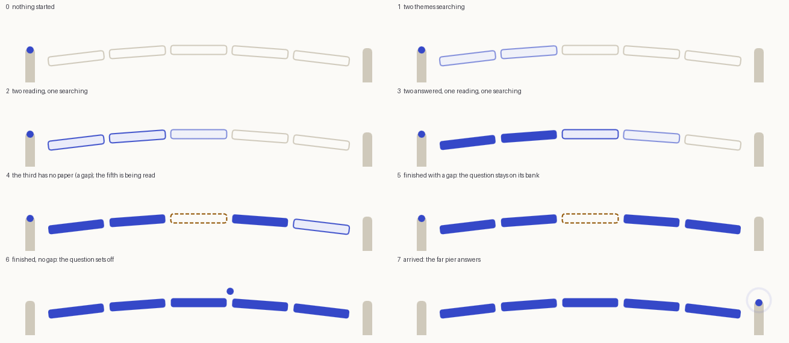
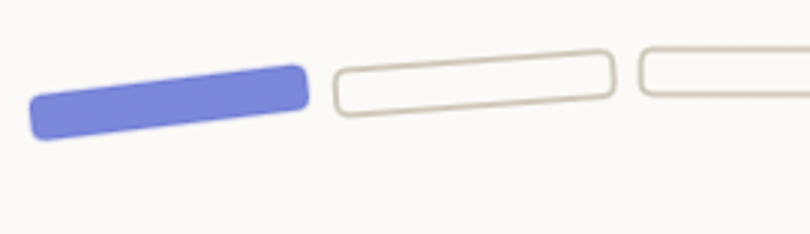
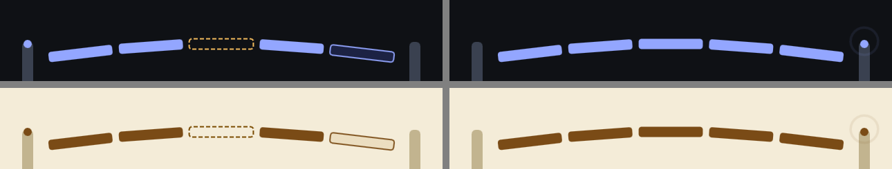

# Setu: a bridge that is laid while a literature scan runs (design brief and spike, 1 Nov 2026)

Asked: with the Rive CLI the owner has installed, find out what we could build that is small and Sodhsetu's own, and how it would be put into the platform. This note is the design (as a designer would
write it), what a first prototype showed, and what is decided or open. **Built in the app on 1 Nov 2026** (status in section 10). The source of the file is [apps/web/rive/setu/](../../apps/web/rive/setu/README.md).

## 1. The problem, from the reader's side

A literature scan takes 30 to 60 seconds. It is the best thing the product does, and the wait is the first impression of it. Today the wait is a thin bar, "2 of 5 themes finished", and a board of
tiles ([ThemeBoard](../../apps/web/src/components/litscan/Review.tsx)). It works and it is accessible, but it is anonymous: nothing says *what is being built*, and a theme with no paper (a "gap", one of
the product's honest features) shows only as small text on a tile. The name Sodhsetu means a bridge between a question and what has been written about it. That is the picture.

## 2. The idea

A small bridge between two piers. The near pier carries the reader's **question** (a dot); the far pier stands for **the papers**. One **plank for each theme** of the scan (2 to 6, as the plan has them).
Planks are laid as themes finish. A theme with no paper leaves **an open plank** (dashed, warm colour), and when the scan ends with no gap the question **crosses** and the far pier answers with one ring;
with a gap the question stays on its bank, which says the same thing the Gaps section says: *not everything could be crossed*.

Principles (from the owner's rules and the earlier design notes: calm, no mascot, trust is quiet):

1. **Honest.** The picture only restates a state the server has stored. A plank is "answered" only when its section is checked and written; it never runs ahead of the work.
2. **Text first.** The bar, the count and the tiles stay as they are and carry every fact. The picture is decoration over real text, as the film on the intro page is.
3. **Quiet.** Motion only while something is happening; opacity pulses (no movement) while working; everything stops when the scan ends.
4. **One idea.** One bridge, one colour of accent, one warm colour for a gap. No character, no sound.
5. **The page's own look.** Colours come from the page's tokens, so light, dark and sepia need no second file.

## 3. The states (storyboard)

| Plank | Looks | Means | Motion |
|---|---|---|---|
| waiting | outline, border colour | not started | none |
| searching | outline in the accent, soft fill, faint | the papers are being searched | opacity 25% to 70% and back, 1.2 s |
| reading | the same, firmer | the abstracts are being read | opacity 70% to 100% and back, 1.2 s |
| answered | solid accent | the section is checked and written | settles 8 px into place and fills, 0.4 s |
| gap | dashed outline, warm colour | no paper answered this theme | fades in, 0.3 s |
| crossing | the dot walks the arch, a ring on the far pier | finished, nothing missing | 1.6 s, gentle start and stop |

A gap is never told by colour alone: it is also dashed and empty, so it reads in sepia (where the accent and the warm colour are both brown) and for readers who do not see colour well.
A plank caught half way: 

## 4. Colour: the three themes ([themes](setu/themes.png))

Five colours are properties of the file that the page sets from its own tokens, and may change while it runs (the owner switches theme): `line` (`--border-strong`), `accent` (`--accent`),
`accentSoft` (`--accent-soft`), `warn` (`--warn`), `ink` (`--text`). The artboard has no background, so the page shows through. Checked in light, dark and sepia ("read").

## 5. Where it lives and what the person reads

- Only on the page of a **running** scan, above the progress bar (under the line that says the language and until when), about 96 px high at the card's width of 520 px (it shrinks with the card: at 360 px the strokes are about 1.1 px, to be looked at
  on a real phone, and thickened for small screens if needed). A scan opened after it ended, and a shared scan, show no bridge (the review is what matters there); a scan the person **watched to its end** keeps its still bridge until they leave the page, so that the crossing at the end is seen.
- The canvas is `aria-hidden`. The progress bar, "N of M themes finished", the tiles and the polite status line are the accessible version and do not change.
- **Not mounted at all** when the person prefers reduced motion, when the file or the runtime cannot be loaded (offline, blocked, old browser), or when the scan is not running. The page then looks
  exactly as it does today. The picture is an enhancement and the fallback is the current page.
- Two honest notes on motion rules: the loops move opacity only, slowly (under one flash a second); and movement that starts by itself and lasts more than five seconds is what WCAG 2.2.2 asks to
  be pausable. A loading indicator is generally treated as essential, but that is a reading, not a certainty, so reduced motion switches it off entirely and a lawyer or an auditor can say more.

## 6. Edge cases

| Case | Behaviour |
|---|---|
| 2 to 6 themes | one artboard for each number (`Setu2` to `Setu6`), so planks are always evenly spaced |
| the page is opened while the scan is half done | the page sets every state before the first frame and lets the machine settle (a short, quiet arrival), instead of replaying the scan |
| cancelled or failed | planks that were not answered go back to waiting; the question stays on its bank; the existing text says why |
| a plank is answered out of order | each plank has its own layer: they never wait for each other |
| theme changed while it runs | the five colours are set again; no reload |
| tab hidden or picture scrolled out of view | animation paused (the runtime keeps a frame loop even when nothing moves: about 2% of the main thread) |
| the scan ends | the last states are set, the crossing plays if there is no gap, then the animation is paused |
| a Hindi or Hinglish scan | the picture has no words; nothing to translate |

## 7. How it is built, and what the spike measured

- **The file.** The Rive CLI builds a `.riv` from RML (text). The scene is **generated** by a short script ([gen.py](../../apps/web/rive/setu/gen.py)): five artboards, one view model `Setu`
  (`p1` to `p6` numbers, `cross` boolean, five colours), one state-machine layer for each plank (5 states, transitions by the number) and one for the crossing. It has no scripts, so web runtimes accept it
  without signing (scripts would need a Rive login and `--publish`; the scene needs neither). **40.7 KB raw, 3.5 KB gzip.**
- **The runtime.** `@rive-app/canvas-lite` 2.49.0 (MIT), self-hosted: 116 KB script and 331 KB wasm, gzip (about 450 KB), against 227.6 KB for everything in the first load today. So it is a
  **lazy chunk loaded only when a scan starts running**, never in the first load, and it gets its own line in `apps/web/scripts/budget.mjs`. The CSP already allows `wasm-unsafe-eval`.
- **Lite is enough.** The same file and the same values on the lite and the full runtime (891 KB wasm) give images with **0 pixels differing** ([comparison](setu/lite-vs-full.png)), including the dashed
  gap and the colours. Properties are read and written from JavaScript by name (`viewModelInstance.number("p1")`, `.color("accent")`, `.boolean("cross")`).
- **Cost on the machine** (Edge, 2x pixel ratio, five planks): about 6% of the main thread while the loops run, 19% with the processor 4x slower (the budget the first-paint check uses), 2% when still.
  Load time was about 0.2 s locally. Heap about 4 to 5 MB.
- **Testing the file without a window.** `rive . --screenshot=… --data=p1=3 … --advance=…` renders any state headless, and steps (`--data` after an `--advance`) can play the page's part, so the storyboard
  above is reproducible and a change of look can be compared by `--compare`.

How the page tells the picture (a small pure function, unit-tested): theme state `wait` to 0, stage `searching` to 1, `reading` to 2, `answered` to 3, `gap` to 4; `cross` is true when the scan
completed with no gap. The page picks the artboard by the number of themes.

## 8. Risks

| Risk | What reduces it |
|---|---|
| 450 KB extra on a slow phone | lazy, after the scan has started (the wait is 30 to 60 s anyway); cached by the browser; never in the first load; skipped on data-saver (`Save-Data`) |
| the wasm cannot start | the page behaves as today (nothing is mounted) |
| strokes too thin on a phone | check at 360 and 320 px; a thicker variant for small screens if it is needed |
| it feels like decoration | it carries one fact, the gap, that the tile only whispers; and it is removable by turning one switch |
| a second look to maintain | the scene is generated; the three themes share one file; colours are the page's own |

## 9. Decisions for the owner

1. Is the idea right (a bridge, planks for themes, an open plank for a gap)? The look (colours, mood, thickness, the arch) is the owner's call.
2. Keep the crossing and the ring, or only the planks?
3. The bridge stays, still, for a scan watched to its end and is not shown for one opened later (what was built, so that the crossing is seen). Or also a still bridge as the header of every finished review?
4. Later, the same file could show the stages of reading an uploaded paper; not planned.

## 10. Status (1 Nov 2026)

**Built and tested in the real app** ([Setu.tsx](../../apps/web/src/components/litscan/Setu.tsx), [RivePiece.tsx](../../apps/web/src/components/RivePiece.tsx), [lib/rive.ts](../../apps/web/src/lib/rive.ts),
[packages/shared/src/rive.ts](../../packages/shared/src/rive.ts), [e2e/rive.mjs](../../apps/web/e2e/rive.mjs)):

- **The mapping** from a scan's state to the file (`setuPose`) and the page's colours as the file takes them (`cssColorToArgb`), the decision not to show a picture (`riveBlockedBy`): unit-tested (26 tests with the reading scene's).
- **In a real scan** (the offline stand-ins): the bridge is drawn; it is told six numbers and the crossing; a scan whose themes all end answered sets the question across (`3,3,3,3`, crossing); one with two gaps does not (`3,4,4,3`); the picture moves while a theme is worked on, and once the crossing is done
  and settled the drawing stops changing; the theme changes while it runs and it is redrawn in the new accent; axe is clean; a scan opened after it ended shows none.
- **Layout:** the box has its final size before the picture is drawn (520 x 96), so nothing moves when it arrives.
- **Loading:** nothing of Rive is fetched on the intro, the home page, the scan's input page or the plan; the runtime and the file are fetched when a scan is on the page.
- **Without it:** with reduced motion, with Save-Data, on a 2g connection, without WebAssembly, and with the runtime blocked, the page has no picture and is whole (checked on the upload zone, which has the same gate).
- **Measured in the app:** the runtime's script 55.7 KB (gzip, smaller than the package's own 116 KB because the build keeps only what is used) and its wasm 336.6 KB; the three files of the pictures 3.4 KB; the first load grew by 1.2 KB of script (228.8 of 250 KB) and
  0.8 KB of style (24.0 of 26 KB) for the gate and the boxes. All have lines in `scripts/budget.mjs`.

**Found by the tests, and fixed:** Vite writes a small file into the script as a `data:` address; the CSP forbids fetching one, and the runtime fetches its files, so the two small `.riv` files (1.4 and 3.3 KB) never loaded in a real build (the 40 KB bridge did). A `.riv` is now never inlined
(`build.assetsInlineLimit` in `vite.config.ts`). The crossing takes about 2.4 s but the drawing was stopped after 2.2 s, which would have frozen the ring half way: it is 3 s now.

**Not done:** a look on a real phone (strokes about 1.1 px at 360 px wide); the owner's decisions above (the look, the crossing, whether finished reviews keep a still bridge); `rive_fallback.wasm`: if a browser cannot start the main wasm, the runtime asks a CDN for its fallback, which the CSP refuses
(so that browser shows no picture, and the page is whole).
